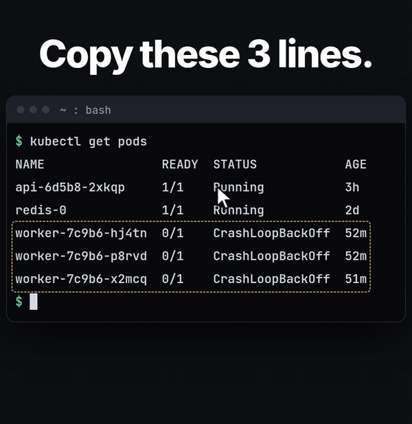

# shellcopy

Copy part of what's on your terminal without touching the mouse. Type `cy`, then the short id in front of the first word you want and the one in front of the last, and press Enter to copy.



Website: https://chuwee.github.io/shellcopy/

## Install

**One line** (Linux and macOS, no sudo). It installs into `~/.local` and adds the shell hook, and running it again updates:

```sh
curl -fsSL https://chuwee.github.io/shellcopy/install.sh | sh
```

Add `sh -s -- --no-rc` in place of the final `sh` to leave your rc files alone.

**Homebrew** (macOS and Linux):

```sh
brew install chuwee/shellcopy/shellcopy
```

**apt** (Debian, Ubuntu): download the `.deb` from the [latest release](https://github.com/Chuwee/shellcopy/releases/latest), then:

```sh
sudo apt install ./shellcopy_*_all.deb
```

Packages can't edit your rc files, so after Homebrew or apt, run this once. It adds the shell hook for bash, zsh and fish, so plain `cy` can pick from what the terminal shows. Running it again is harmless, and `shellcopy setup --remove` takes the hook out.

```sh
shellcopy setup
```

The hook is one line, which `shellcopy init --rc-line SHELL` prints, if you'd rather add it by hand:

```sh
# ~/.bashrc (or ~/.zshrc, with zsh)
command -v shellcopy >/dev/null && eval "$(shellcopy init bash)" && shellcopy record
```

```fish
# ~/.config/fish/conf.d/shellcopy.fish
status is-interactive; and type -q shellcopy; and shellcopy init fish | source; and shellcopy record
```

**From a checkout:**

```sh
./install.sh            # puts pyte in vendor/ (no venv, pip or sudo), links `shellcopy` and `cy` into ~/.local/bin,
                        # and runs `shellcopy setup`
./install.sh --no-rc    # same, without touching your rc files
```

Then open a new terminal, run something, and type `cy`.

### Shells

`cy` is a plain command, so it works from any shell: bash, zsh, fish, ksh, dash, nushell, xonsh, and others. The hook (`shellcopy init bash|zsh|fish|sh|ksh`) adds two things: it turns on recording, and it hands `cy` your history so it can re-run your last command in a terminal that isn't recorded. For a shell without a hook, add the equivalent of this line to its startup file to turn on recording:

```sh
shellcopy record --check && exec shellcopy record
```

`shellcopy record [SHELL]` runs `SHELL` (by default `$SHELL`) with the terminal recorded, and `--check` tells you whether this terminal should be recorded at all. That way the line does nothing in tmux, in VS Code, or in a terminal that's already recorded.

## How it works

**Ids (the default).** When `cy` opens, every word on screen gets a short id in front of it, easiest to type first. Type one id to start the selection at that word and another to end it there, then press Enter to copy, or fine-tune with the arrows first. With Shift, an id copies right away: `Shift`+id alone copies that word. The ids are inserted in front of their words, pushing the line right while they're shown, so they never cover text.

**Halving (Tab).** Tab switches to halving. Each arrow keeps the half of the remaining words it points at, and the rest dims. A line under a row shows where ↑/↓ would cut, and a │ shows where ←/→ would, so you can see what each arrow keeps before you press it. A screen of 100 near-identical IPs takes about 7 presses. When one word is left, a cursor lands on it.

**The cursor.** Once a word is picked, the arrows move the cursor one character at a time. Press Enter to start selecting, move, and press Enter again to copy.

`cy` remembers whichever mode you last switched to with Tab (in `~/.local/state/shellcopy/mode`) and opens in it next time. `cy --ids` or `cy --halve`, or `SHELLCOPY_MODE=ids|halve`, picks one for a run.

| Key | Ids | Halving | With the cursor |
|---|---|---|---|
| id | first: start at that word; second: end there, then Enter copies | | |
| Shift + id | copy right away: that word, or up to it when a start is picked | | (same, in ids mode) |
| ← → ↑ ↓ | | keep that half of the words | move one character or line |
| Enter | | put the cursor on the first word left | first time: start selecting; second time: copy |
| Tab | switch to halving | switch to ids | toggle ids on every word on screen |
| Shift + ← → | | | jump a whole word (while selecting forward, to the word's end so it's included) |
| Shift + ↑ ↓ | | | jump 5 lines; PgUp/PgDn a page; Home/End line start and end |
| Space | | | select whole lines |
| z | | | halve again from the whole screen (keeps your selection) |
| Backspace | clear the start; with none, quit | undo the last halving; at the start, quit | clear the selection; with nothing selected, back to picking |
| Esc | quit | quit | quit |

## Where the text comes from

- **`cy`** picks from what this terminal shows, scrollback included. This needs the shell hook, which the install script or `shellcopy setup` adds. It replaces your shell with one running inside `script` (the util-linux one on Linux, the built-in one on macOS), which logs what the terminal prints (text only, no keystrokes) to a private file readable only by you. On Linux, that file is in memory under `$XDG_RUNTIME_DIR`, and on macOS it's in your per-user temp folder. It's trimmed past 8 MB and deleted when the terminal closes. A small shellcopy process stays alive alongside it to do the trimming and cleanup. Remove the line, or set `SHELLCOPY_RECORD=0`, to turn it off. Recording is skipped inside tmux, where `cy` reads the screen directly, and in VS Code's terminal.
- **`cmd | cy`** picks from `cmd`'s output.
- In a terminal that isn't recorded, plain `cy` offers to re-run your last command and capture its output. This needs the bash, zsh or fish hook, which passes your history. The command runs in a fresh copy of your shell, so aliases and functions defined in your rc files aren't available.
- **`cy --print`** prints the selection instead of copying it, for `x=$(cy --print)`.

It copies with `wl-copy`, `xclip`, `xsel` or `pbcopy`, whichever is installed, and otherwise asks the terminal to copy (OSC 52).

## Limits

- Resizing the window can make the rebuilt screen slightly off.
- Long lines that the terminal wrapped come back as separate lines.

## Releasing

1. Bump `__version__` in `shellcopy.py`, commit, then tag and push: `git tag v0.1.0 && git push origin v0.1.0`. The release workflow builds the `.deb` (`packaging/deb/build.sh`) and attaches it to a GitHub release.
2. Run `packaging/homebrew/update-formula.sh` to fill in the formula's url and sha256, then copy `packaging/homebrew/shellcopy.rb` to `Formula/shellcopy.rb` in the tap repo, [Chuwee/homebrew-shellcopy](https://github.com/Chuwee/homebrew-shellcopy).

## License

MIT, see [LICENSE](LICENSE).
